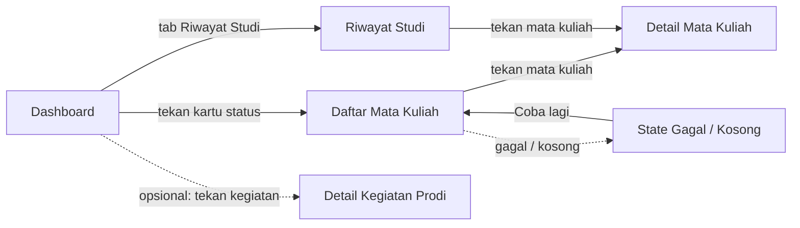

# PRD — myUMM Student: Drill-down Status Mata Kuliah

| | |
|---|---|
| **Produk** | myUMM Student (aplikasi mobile iOS & Android) |
| **Fitur** | Drill-down dari kartu ringkasan mata kuliah ke daftar dan rincian mata kuliah |
| **Penyusun** | Tifsan Ariel Pratama (202310370311349) — Rekayasa Interaksi C |
| **Sumber kebutuhan** | Worksheet 8 — UX Requirements (UXR-01 s.d. UXR-08) |
| **Status** | Prototype (data dummy, tanpa backend) |
| **Versi PRD** | 1.0 |

---

## 1. Ringkasan

Di dashboard myUMM Student ada kartu ringkasan jumlah mata kuliah (Lulus, Belum Lulus, Sedang Ditempuh). Kartu ini **terlihat bisa ditekan tetapi statis**. Pada observasi, ketiga partisipan (R1–R3) menekan kartu tersebut, tidak mendapat apa pun, lalu menebak-nebak menu, menutup aplikasi, atau pindah ke web portal.

Prototype ini mengubah kartu ringkasan menjadi pintu masuk ke **daftar nama mata kuliah** sesuai statusnya, lengkap dengan informasi yang dibutuhkan untuk menyusun KRS. Prototype juga menyediakan jalur cadangan lewat menu **Riwayat Studi**.

## 2. Masalah yang Diselesaikan

| Kode | Masalah | Dijawab oleh |
|---|---|---|
| M1 | Dashboard hanya menampilkan angka, tanpa nama mata kuliah | FR-02, FR-03 |
| M2 | Kartu tampak bisa ditekan tetapi statis (*misleading affordance*) | FR-01 |
| M3 | Tidak ada umpan balik saat kartu ditekan, sehingga pengguna menekan berulang kali | FR-05 |
| M4 | Jalur menuju rincian tidak jelas | FR-06 |
| M5 | Pengguna berhenti di jalan buntu | FR-07 |
| M6 | Harus pindah ke web portal untuk melihat rincian | FR-02, FR-04 |
| M7 | Khawatir ada mata kuliah wajib yang belum lulus | FR-03 |
| M8 | Jadwal Kegiatan Prodi tidak bisa dibuka | FR-08 (opsional) |

## 3. Tujuan dan Metrik Keberhasilan

Tujuan pengguna (WS8): **T1** mengetahui daftar mata kuliah per status dari aplikasi mobile, **T2** memastikan syarat kelulusan dan prasyarat terpenuhi, **T3** menyusun KRS tanpa ada mata kuliah yang tertinggal.

| Metrik | Target awal | Sumber |
|---|---|---|
| Ketukan dari dashboard ke daftar mata kuliah per status | 1 ketukan | UXR-01 |
| Respons visual setelah ketukan | ≤ 0,1 detik; indikator proses bila muat > 1 detik | UXR-02 |
| Partisipan benar menunjuk elemen yang bisa dibuka (uji first-click) | ≥ 80% | UXR-03 |
| Waktu menjawab "mata kuliah wajib apa yang belum lulus?" | ≤ 30 detik dari halaman daftar | UXR-04 |
| Ketukan dari dashboard ke Riwayat Studi | ≤ 2 ketukan | UXR-05 |
| Layar kosong/gagal tanpa pesan dan aksi lanjutan | 0 | UXR-06 |

> Angka di atas adalah target awal dari WS8, bukan hasil pengukuran. Target ini divalidasi lewat usability testing pada prototype.

## 4. Pengguna

**Pengguna utama:** mahasiswa aktif UMM yang membuka myUMM Student lewat ponsel, terutama menjelang masa KRS.
**Konteks:** penggunaan singkat dan sambil lalu. Pengguna ingin jawaban cepat dan cenderung menutup aplikasi setelah beberapa kali gagal (WS6, Behaviors c).

## 5. Ruang Lingkup

**Termasuk (prototype ini):**
- Dashboard dengan kartu ringkasan yang bisa ditekan
- Daftar mata kuliah per status (Lulus, Belum Lulus, Sedang Ditempuh)
- Detail mata kuliah
- Halaman Riwayat Studi (jalur cadangan dari navigasi bawah)
- State loading, kosong, dan gagal
- *(Opsional)* Detail Jadwal Kegiatan Prodi

**Tidak termasuk:**
- Desain ulang seluruh dashboard dan menu lain di luar status studi (WS8: *Won't have*)
- Login sungguhan, integrasi API kampus, dan backend. Seluruh data berupa dummy lokal.
- Pengisian KRS
- Notifikasi pengingat KRS (UXR-08, *Could have*, belum divalidasi)

## 6. User Flow

### 6.1 Alur utama: menemukan mata kuliah yang belum lulus
1. Pengguna membuka aplikasi, dan **Dashboard** tampil.
2. Pengguna melihat kartu "Belum Lulus: 3". Kartu menampilkan ikon "›" dan teks "Lihat rincian".
3. Pengguna menekan kartu. Efek tekan langsung muncul, lalu indikator loading tampil bila perlu.
4. **Daftar Mata Kuliah** terbuka dengan tab "Belum Lulus" aktif.
5. Pengguna melihat nama mata kuliah, SKS, semester, dan label "Wajib".
6. Pengguna menekan salah satu mata kuliah, dan **Detail Mata Kuliah** terbuka.
7. Pengguna kembali ke daftar lewat tombol kembali.

### 6.2 Alur cadangan: lewat menu
1. Dari Dashboard, pengguna menekan tab **Riwayat Studi** di navigasi bawah.
2. **Riwayat Studi** tampil dengan ringkasan IPK, SKS, dan mata kuliah per semester.
3. Pengguna menekan salah satu mata kuliah, dan **Detail Mata Kuliah** terbuka.

### 6.3 Alur pengecualian
- Data gagal dimuat: tampil pesan penyebab dan tombol **"Coba lagi"**.
- Daftar kosong (misalnya tidak ada mata kuliah belum lulus): tampil pesan positif dan aksi lanjutan, misalnya "Lihat Riwayat Studi".



## 7. Daftar Layar dan Komponen

| ID | Layar | Komponen utama | UXR |
|---|---|---|---|
| S1 | **Dashboard** | Header (nama, NIM, prodi); 3 kartu ringkasan (Lulus, Belum Lulus, Sedang Ditempuh) dengan angka, ikon "›", dan teks "Lihat rincian"; bagian Jadwal Kegiatan Prodi; navigasi bawah (Beranda, Riwayat Studi, Profil) | 01, 02, 03, 07 |
| S2 | **Daftar Mata Kuliah** | App bar dengan tombol kembali dan judul; tab segmented (Lulus, Belum Lulus, Sedang Ditempuh) dengan jumlah; ringkasan singkat (total SKS pada tab aktif); item list berisi nama, kode, SKS, semester, nilai (bila ada), label "Wajib" atau "Prasyarat"; filter "Hanya wajib" | 01, 04 |
| S3 | **Detail Mata Kuliah** | Nama dan kode; badge status; SKS, semester, nilai, jenis (wajib/pilihan); daftar prasyarat beserta statusnya; mata kuliah yang membutuhkan mata kuliah ini sebagai prasyarat | 04 |
| S4 | **Riwayat Studi** | Ringkasan IPK dan total SKS lulus; daftar per semester yang bisa dibuka-tutup; item mata kuliah yang bisa ditekan | 05 |
| S5 | **State Loading / Kosong / Gagal** | Skeleton/spinner; ilustrasi sederhana + pesan + 1 tombol aksi ("Coba lagi" atau "Lihat Riwayat Studi") | 02, 06 |
| S6 | *(Opsional)* **Detail Kegiatan Prodi** | Judul, tanggal, waktu, tempat, deskripsi | 07 |

## 8. Kebutuhan Fungsional

| ID | Kebutuhan | Prioritas | UXR |
|---|---|---|---|
| FR-01 | Setiap kartu ringkasan di Dashboard **bisa ditekan** dan memiliki penanda visual bahwa kartu bisa dibuka (ikon "›" + teks "Lihat rincian"). Elemen yang hanya informasi **tidak boleh** tampil seperti tombol. | Must | 03 |
| FR-02 | Menekan kartu membuka S2 dengan **tab sesuai kartu yang ditekan** sudah aktif. | Must | 01 |
| FR-03 | S2 menampilkan nama, kode, SKS, semester, dan label wajib/prasyarat untuk setiap mata kuliah. Ada filter "Hanya wajib". Jumlah di tab harus **sama** dengan angka di kartu Dashboard. | Should | 04 |
| FR-04 | Menekan item mata kuliah di S2 atau S4 membuka S3. | Should | 01, 04 |
| FR-05 | Setiap elemen yang bisa ditekan memberi **umpan balik visual langsung** (ripple/highlight). Bila pemuatan > 1 detik, tampil indikator proses. Selama proses, elemen yang sama tidak memicu navigasi ganda. | Must | 02 |
| FR-06 | Navigasi bawah memiliki tab **Riwayat Studi** yang selalu terlihat. | Should | 05 |
| FR-07 | Setiap kondisi kosong atau gagal menampilkan penyebab singkat dan **satu aksi lanjutan**. Prototype menyediakan cara memicu state gagal untuk keperluan demo (misalnya toggle di layar Profil: "Simulasikan gagal memuat"). | Should | 06 |
| FR-08 | *(Opsional)* Item Jadwal Kegiatan Prodi di Dashboard bisa ditekan dan membuka S6. | Could | 07 |

## 9. Kebutuhan Non-fungsional

- **Platform:** iOS dan Android lewat Expo (React Native), dan bisa dibuka di browser (Expo Web) agar prototype bisa diakses lewat link.
- **Bahasa antarmuka:** Bahasa Indonesia, dengan istilah yang konsisten di semua layar ("Lulus", "Belum Lulus", "Sedang Ditempuh", "Riwayat Studi", "Lihat rincian").
- **Performa yang dirasakan:** umpan balik ketukan ≤ 100 ms. Data dummy dimuat dengan jeda simulasi ±600 ms agar state loading terlihat.
- **Aksesibilitas:** area sentuh minimal 44×44 pt; kontras teks memenuhi WCAG AA; status tidak hanya dibedakan dengan warna (selalu disertai teks/label); elemen interaktif memiliki `accessibilityLabel`.
- **Kualitas kode:** TypeScript; komponen dipisah per layar; data dummy di satu file.

## 10. Data (Dummy)

Seluruh data bersifat fiktif dan disimpan lokal (`src/data/`).

```ts
type StatusMK = "lulus" | "belum_lulus" | "ditempuh";

interface MataKuliah {
  kode: string;          // contoh: "IF201"
  nama: string;
  sks: number;
  semester: number;      // semester pengambilan dalam kurikulum
  status: StatusMK;
  nilai?: string;        // "A", "B+", ..., "D", "E"; kosong bila sedang ditempuh
  wajib: boolean;
  prasyarat: string[];   // daftar kode mata kuliah
}
```

- **Definisi status:** *Lulus* = nilai memenuhi batas lulus; *Belum Lulus* = sudah pernah diambil tetapi nilai belum memenuhi batas lulus; *Sedang Ditempuh* = diambil pada semester berjalan.
- **Volume dummy:** ±30 mata kuliah dari semester 1–6, termasuk minimal 3 mata kuliah Belum Lulus (minimal 2 di antaranya wajib) dan 6 mata kuliah Sedang Ditempuh.
- Angka di kartu Dashboard **dihitung dari data**, bukan ditulis manual.

## 11. Acceptance Criteria

1. Dari Dashboard, menekan kartu "Belum Lulus" membuka daftar mata kuliah belum lulus dalam **1 ketukan**, dengan tab yang benar sudah aktif.
2. Setiap kartu dan item list memberi umpan balik visual saat ditekan.
3. Angka di setiap kartu sama dengan jumlah item di tab terkait.
4. Mata kuliah wajib yang belum lulus bisa diidentifikasi dari S2 tanpa membuka S3 (label "Wajib" terlihat di item list, dan filter "Hanya wajib" berfungsi).
5. Riwayat Studi bisa dicapai dalam ≤ 2 ketukan dari Dashboard.
6. State gagal menampilkan pesan + tombol "Coba lagi" yang berfungsi. State kosong menampilkan pesan + aksi lanjutan.
7. Alur utama (6.1) dan alur cadangan (6.2) bisa dijalankan dari awal sampai akhir tanpa jalan buntu.
8. Aplikasi berjalan di Expo Go (Android/iOS) dan di browser lewat `npx expo start --web`.

## 12. Teknologi

- Expo SDK (versi stabil terbaru) + TypeScript
- Navigasi: Expo Router (tab bawah + stack)
- Tanpa backend; data dari file lokal dengan jeda simulasi

## 13. Proses Pengerjaan dan Change Log

- Kerjakan secara bertahap sesuai milestone di bawah. **Setiap milestone = minimal 1 commit** dengan pesan yang jelas dalam Bahasa Indonesia (misalnya `feat: kartu ringkasan bisa ditekan (FR-01)`).
- Setiap perubahan dicatat di `CHANGELOG.md` dengan format *Keep a Changelog*. Sebutkan ID kebutuhan (FR/UXR) yang dikerjakan.
- `README.md` berisi cara menjalankan aplikasi dan link prototype.

## 14. Milestone

| # | Milestone | Isi |
|---|---|---|
| 1 | Setup | Inisialisasi Expo + TypeScript, struktur folder, data dummy |
| 2 | Dashboard | S1 + kartu yang bisa ditekan + umpan balik (FR-01, FR-05) |
| 3 | Daftar & Detail | S2 + S3 + navigasi dari kartu (FR-02, FR-03, FR-04) |
| 4 | Riwayat Studi | S4 + navigasi bawah (FR-06) |
| 5 | State | Loading, kosong, gagal (FR-07) |
| 6 | Opsional | S6 Jadwal Kegiatan Prodi (FR-08) |
| 7 | Rapikan | Cek acceptance criteria, update README dan CHANGELOG |
