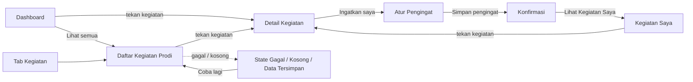

# PRD v2 — myUMM Student: Jadwal Kegiatan Prodi

| | |
|---|---|
| **Produk** | myUMM Student (aplikasi mobile iOS & Android) |
| **Fitur utama** | Jadwal Kegiatan Prodi: melihat kegiatan terbaru, membuka detail, dan menyimpan pengingat |
| **Penyusun** | Tifsan Ariel Pratama (202310370311349) — Rekayasa Interaksi C |
| **Sumber kebutuhan** | Worksheet 8 (M8, UXR-07) dan pengalaman langsung penyusun sebagai pengguna myUMM Student |
| **Status** | Prototype (data dummy, tanpa backend) |
| **Versi PRD** | 2.0 — menggantikan fokus v1 (drill-down status mata kuliah) |

> **Catatan perubahan dari v1:** Fokus utama berpindah dari kartu ringkasan mata kuliah ke Jadwal Kegiatan Prodi. Fitur status mata kuliah yang sudah dibangun di v1 **tetap dipertahankan dan tidak diubah**, kecuali penyesuaian navigasi bawah (§7).

---

## 1. Ringkasan

Di dashboard myUMM Student ada bagian **Jadwal Kegiatan Prodi**. Di aplikasi saat ini, bagian tersebut **tidak dapat dibuka** dan **tidak memuat kegiatan terbaru**. Akibatnya mahasiswa tidak tahu kegiatan apa yang akan datang (seminar, workshop, kuliah tamu, lomba) dan harus mencari di kanal lain seperti grup chat atau media sosial prodi.

Prototype ini merancang ulang Jadwal Kegiatan Prodi menjadi alur yang utuh. Pengguna bisa **melihat kegiatan terbaru**, **membuka detailnya**, dan **menyimpan pengingat**. Ada juga penanganan yang jelas ketika data gagal dimuat.

## 2. Masalah yang Diselesaikan

| Kode | Masalah | Dijawab oleh |
|---|---|---|
| M8 | Bagian Jadwal Kegiatan Prodi di dashboard tidak dapat dibuka | FR-01, FR-02, FR-04 |
| M9 | Kegiatan terbaru tidak termuat, sehingga pengguna melihat informasi usang atau kosong tanpa penjelasan | FR-03, FR-07, FR-08 |
| M10 | Pengguna tidak tahu kapan data terakhir diperbarui, sehingga tidak yakin informasinya masih berlaku | FR-03 |
| M11 | Pengguna harus mencari informasi kegiatan di kanal lain (grup chat, media sosial) | FR-02, FR-04 |
| M12 | Pengguna mudah lupa jadwal kegiatan yang ingin diikuti | FR-05, FR-06 |

> M9–M12 berasal dari pengalaman langsung penyusun dan **belum tercantum di WS8**. Masalah ini perlu ditambahkan pada revisi WS8 dan divalidasi melalui uji pengguna.

## 3. Tujuan dan Metrik Keberhasilan

**Tujuan pengguna:**
- **T1.** Mengetahui kegiatan prodi yang akan datang langsung dari aplikasi.
- **T2.** Yakin bahwa informasi kegiatan yang dilihat adalah yang terbaru.
- **T3.** Tidak melewatkan kegiatan yang ingin diikuti.

| Metrik | Target awal | Sumber |
|---|---|---|
| Ketukan dari Dashboard ke detail kegiatan terdekat | 1 ketukan | UXR-07 |
| Ketukan dari Dashboard ke daftar semua kegiatan | ≤ 2 ketukan | UXR-07 |
| Waktu menemukan kegiatan terdekat beserta tanggalnya | ≤ 10 detik | UXR-07 |
| Waktu menyimpan pengingat dari halaman detail | ≤ 3 ketukan, ≤ 15 detik | T3 |
| Pengguna dapat menyebutkan kapan data terakhir diperbarui | ≥ 80% partisipan | T2 |
| Layar gagal/kosong tanpa pesan dan aksi lanjutan | 0 | UXR-06 |

> Angka di atas adalah target awal, bukan hasil pengukuran. Target ini divalidasi lewat usability testing.

## 4. Pengguna

**Pengguna utama:** mahasiswa aktif UMM yang ingin mengikuti kegiatan prodi untuk menambah wawasan, memenuhi poin kegiatan, atau mendapatkan sertifikat.
**Konteks:** membuka aplikasi sebentar di sela kuliah, ingin tahu "ada kegiatan apa minggu ini?" dengan cepat.

## 5. Ruang Lingkup

**Termasuk:**
- Bagian Jadwal Kegiatan Prodi di Dashboard (pratinjau kegiatan terdekat)
- Halaman Daftar Kegiatan Prodi (urut terdekat, filter, muat ulang)
- Halaman Detail Kegiatan
- Atur Pengingat dan konfirmasinya
- Halaman Kegiatan Saya (daftar kegiatan yang diberi pengingat)
- State loading, kosong, gagal, dan data tersimpan (offline)
- Tab **Kegiatan** di navigasi bawah

**Tidak termasuk:**
- Perubahan pada fitur status mata kuliah dari v1 (tetap seperti sekarang)
- Pendaftaran kegiatan di dalam aplikasi (cukup tautan ke formulir eksternal bila ada)
- Notifikasi sistem sungguhan (push notification). Pengingat disimpan lokal dan disimulasikan.
- Login sungguhan, API kampus, dan backend

## 6. User Flow

### 6.1 Alur utama: menemukan kegiatan dan menyimpan pengingat
1. Pengguna membuka aplikasi, dan **Dashboard** tampil.
2. Di bagian **Jadwal Kegiatan Prodi** terlihat 3 kegiatan terdekat, keterangan "Diperbarui …", dan tautan "Lihat semua ›".
3. Pengguna menekan "Lihat semua ›", dan **Daftar Kegiatan Prodi** terbuka.
4. Pengguna menarik layar ke bawah untuk memuat ulang. Kegiatan baru muncul dengan label **"Baru"**.
5. Pengguna menekan salah satu kegiatan, dan **Detail Kegiatan** terbuka.
6. Pengguna menekan **"Ingatkan saya"**, dan **Atur Pengingat** tampil.
7. Pengguna memilih waktu pengingat lalu menekan **"Simpan pengingat"**.
8. **Konfirmasi** tampil: "Pengingat disimpan". Ada tombol "Lihat Kegiatan Saya".
9. Pengguna membuka **Kegiatan Saya**, dan kegiatan tersebut tercantum di sana.

### 6.2 Alur cepat
Dashboard → tekan salah satu kegiatan di pratinjau → **Detail Kegiatan** (1 ketukan).

### 6.3 Alur cadangan
Navigasi bawah → tab **Kegiatan** → Daftar Kegiatan Prodi.

### 6.4 Alur pengecualian
- **Gagal memuat, tanpa data tersimpan:** pesan penyebab + tombol **"Coba lagi"**.
- **Gagal memuat, ada data tersimpan:** tetap tampilkan data terakhir, dengan banner "Menampilkan data terakhir (diperbarui …). Coba lagi".
- **Tidak ada kegiatan akan datang:** pesan + aksi "Lihat kegiatan selesai".
- **Kegiatan Saya kosong:** pesan + aksi "Jelajahi kegiatan".



## 7. Daftar Layar dan Komponen

| ID | Layar | Komponen utama |
|---|---|---|
| K1 | **Dashboard: bagian Jadwal Kegiatan Prodi** | Judul bagian + keterangan "Diperbarui [waktu]"; 3 kartu kegiatan terdekat (tanggal, judul, waktu, tempat, label "Baru"/"Hari ini"/"Besok"); setiap kartu bisa ditekan (chevron "›"); tautan "Lihat semua ›" |
| K2 | **Daftar Kegiatan Prodi** | App bar + kembali; tab **Akan Datang / Selesai** dengan jumlah; chip filter kategori (Semua, Seminar, Workshop, Kuliah Tamu, Lomba, Akademik); keterangan "Diperbarui [waktu]"; list kegiatan dikelompokkan per minggu ("Minggu ini", "Minggu depan", "Bulan ini", "Nanti"); tarik untuk muat ulang; ikon lonceng pada kegiatan yang sudah diberi pengingat |
| K3 | **Detail Kegiatan** | Kategori + judul; tanggal, waktu, tempat/mode (luring/daring); penyelenggara; deskripsi; status pendaftaran (Dibuka/Ditutup/Tanpa pendaftaran); tombol utama **"Ingatkan saya"** (berubah jadi "Pengingat aktif · Ubah" bila sudah diatur); tombol sekunder **"Daftar"** bila ada tautan |
| K4 | **Atur Pengingat** (bottom sheet) | Judul kegiatan; pilihan waktu (radio): "1 hari sebelumnya", "3 jam sebelumnya", "1 jam sebelumnya"; tombol **"Simpan pengingat"**; tombol "Batal"; bila sudah ada pengingat: tombol **"Hapus pengingat"** |
| K5 | **Konfirmasi Pengingat** | Ikon centang, "Pengingat disimpan", ringkasan ("Kamu akan diingatkan 1 hari sebelum [judul], [tanggal]"); tombol **"Lihat Kegiatan Saya"** dan "Kembali ke kegiatan" |
| K6 | **Kegiatan Saya** | Daftar kegiatan yang diberi pengingat, urut terdekat; tiap item menampilkan waktu pengingat; tekan item → K3; state kosong |
| K7 | **State Loading / Gagal / Kosong / Data Tersimpan** | Skeleton list; pesan gagal + "Coba lagi"; banner data tersimpan; pesan kosong + 1 aksi |

**Navigasi bawah (diperbarui):** Beranda · **Kegiatan** · Riwayat Studi · Profil.
Tab **Kegiatan** membuka K2. K6 dapat dibuka dari ikon/tautan "Kegiatan Saya" di app bar K2 dan dari K5.

## 8. Kebutuhan Fungsional

| ID | Kebutuhan | Prioritas |
|---|---|---|
| FR-01 | Bagian Jadwal Kegiatan Prodi di Dashboard menampilkan **3 kegiatan akan datang yang terdekat**. Setiap kartu bisa ditekan dan membuka K3. Bagian ini punya tautan **"Lihat semua ›"** ke K2. | Must |
| FR-02 | K2 menampilkan semua kegiatan dengan tab Akan Datang/Selesai, filter kategori, dan pengelompokan per minggu. Urutan Akan Datang: terdekat dulu. Urutan Selesai: terbaru dulu. | Must |
| FR-03 | K1 dan K2 menampilkan **"Diperbarui [waktu]"** (misalnya "Diperbarui 5 menit lalu"). K2 mendukung **tarik untuk muat ulang**. Pada demo, muat ulang pertama menambahkan 1 kegiatan baru agar efeknya terlihat. | Must |
| FR-04 | K3 menampilkan informasi lengkap kegiatan. Tombol "Daftar" hanya muncul bila kegiatan punya tautan pendaftaran dan statusnya Dibuka. | Must |
| FR-05 | Dari K3, pengguna dapat **mengatur, mengubah, dan menghapus pengingat** lewat K4. Pengingat disimpan lokal (AsyncStorage) dan tetap ada setelah aplikasi dibuka ulang. | Should |
| FR-06 | Setelah menyimpan pengingat, tampil K5. K6 menampilkan semua kegiatan yang diberi pengingat. | Should |
| FR-07 | Setiap layar data menangani loading (skeleton), gagal, dan kosong dengan pesan + satu aksi lanjutan. | Must |
| FR-08 | Bila gagal memuat tetapi ada data tersimpan dari pemuatan sebelumnya, **tampilkan data tersebut** beserta banner waktu pembaruan terakhir dan tombol "Coba lagi". | Should |
| FR-09 | Label **"Baru"** untuk kegiatan yang ditambahkan ≤ 3 hari terakhir; label **"Hari ini"**/**"Besok"** untuk kegiatan pada hari itu/besok. | Should |
| FR-10 | Layar Profil menyediakan toggle demo: "Simulasikan gagal memuat kegiatan" dan "Simulasikan tidak ada kegiatan". Toggle simulasi lama dari v1 tetap ada. | Should |
| FR-11 | Setiap elemen yang bisa ditekan memberi umpan balik visual langsung, dan elemen informasi statis tidak tampil seperti tombol. | Must |

## 9. Kebutuhan Non-fungsional

- **Platform:** Expo (React Native) untuk iOS/Android, bisa dibuka di browser lewat Expo Web.
- **Bahasa:** Bahasa Indonesia dengan istilah konsisten ("Jadwal Kegiatan Prodi", "Kegiatan Saya", "Ingatkan saya", "Simpan pengingat", "Akan Datang", "Selesai", "Coba lagi").
- **Format tanggal:** Indonesia, misalnya "Sen, 24 Nov 2026 · 09.00 WIB".
- **Performa yang dirasakan:** umpan balik ketukan ≤ 100 ms; data dummy dimuat dengan jeda simulasi ±600 ms.
- **Aksesibilitas:** area sentuh ≥ 44×44 pt, kontras WCAG AA, label tidak hanya mengandalkan warna, `accessibilityLabel` pada elemen interaktif.
- **Kode:** TypeScript; jangan merusak fitur v1; data kegiatan di file terpisah (`src/data/kegiatan.ts`).

## 10. Data (Dummy)

```ts
type KategoriKegiatan = "Seminar" | "Workshop" | "Kuliah Tamu" | "Lomba" | "Akademik";
type StatusPendaftaran = "dibuka" | "ditutup" | "tanpa_pendaftaran";

interface Kegiatan {
  id: string;
  judul: string;
  kategori: KategoriKegiatan;
  mulai: string;            // ISO datetime
  selesai?: string;         // ISO datetime
  mode: "luring" | "daring";
  tempat: string;           // ruang/gedung atau nama platform daring
  penyelenggara: string;
  deskripsi: string;
  statusPendaftaran: StatusPendaftaran;
  tautanPendaftaran?: string;
  ditambahkanPada: string;  // ISO datetime, untuk label "Baru"
}

interface Pengingat {
  kegiatanId: string;
  waktu: "1_hari" | "3_jam" | "1_jam";
  dibuatPada: string;
}
```

- **Tanggal dibuat relatif terhadap hari ini** saat aplikasi dijalankan (misalnya `hariIni + 2 hari`), supaya prototype selalu menampilkan kegiatan "terbaru" kapan pun didemokan.
- **Volume:** ±14 kegiatan: ±10 akan datang (minimal 1 hari ini, 1 besok, 2 berlabel "Baru") dan ±4 selesai. Semua kategori terwakili.
- Semua data bersifat fiktif.

## 11. Acceptance Criteria

1. Dari Dashboard, kegiatan terdekat bisa dibuka dalam **1 ketukan**, dan daftar semua kegiatan dalam **≤ 2 ketukan**.
2. K1 dan K2 menampilkan keterangan waktu pembaruan terakhir. Tarik untuk muat ulang di K2 berfungsi dan memunculkan kegiatan baru berlabel "Baru".
3. Kegiatan di tab Akan Datang terurut dari yang terdekat dan dikelompokkan per minggu. Filter kategori berfungsi.
4. Pengingat bisa disimpan dari K3 dalam ≤ 3 ketukan, muncul di K6, tetap ada setelah aplikasi dibuka ulang, dan bisa diubah atau dihapus.
5. Gagal memuat tanpa data tersimpan menampilkan pesan + "Coba lagi". Gagal memuat dengan data tersimpan tetap menampilkan data beserta banner.
6. Setiap kondisi kosong menampilkan pesan + satu aksi lanjutan.
7. Alur 6.1 bisa dijalankan dari awal sampai akhir tanpa jalan buntu, melewati **minimal 5 layar** (K1 → K2 → K3 → K4 → K5 → K6).
8. Fitur status mata kuliah dari v1 tetap berfungsi seperti sebelumnya.
9. Aplikasi berjalan di Expo Go dan di browser (`npx expo start --web`) tanpa error TypeScript.

## 12. Teknologi

- Expo + TypeScript + Expo Router (melanjutkan project v1)
- `@react-native-async-storage/async-storage` untuk pengingat dan data tersimpan
- Tanpa backend; data dari file lokal dengan jeda simulasi

## 13. Proses Pengerjaan dan Change Log

- Lanjutkan dari kode yang sudah ada. Jangan membuat project baru.
- Setiap milestone = minimal 1 commit, pesan dalam Bahasa Indonesia yang menyebut ID kebutuhan (contoh: `feat: daftar kegiatan prodi dengan filter kategori (FR-02)`).
- Catat setiap perubahan di `CHANGELOG.md` dengan format *Keep a Changelog*, di bawah versi baru **`[0.2.0]`**.
- Perbarui `README.md` (fitur dan cara mencoba alur kegiatan prodi).

## 14. Milestone

| # | Milestone | Isi |
|---|---|---|
| 1 | Data | Model dan data dummy kegiatan dengan tanggal relatif; penyimpanan lokal pengingat dan cache |
| 2 | Dashboard | K1 + navigasi ke K2/K3 + tab Kegiatan di navigasi bawah (FR-01, FR-11) |
| 3 | Daftar Kegiatan | K2: tab, filter, pengelompokan, "Diperbarui", tarik untuk muat ulang, label (FR-02, FR-03, FR-09) |
| 4 | Detail Kegiatan | K3 (FR-04) |
| 5 | Pengingat | K4, K5, K6 (FR-05, FR-06) |
| 6 | State | Loading, gagal, kosong, data tersimpan, toggle demo di Profil (FR-07, FR-08, FR-10) |
| 7 | Rapikan | Cek acceptance criteria termasuk fitur v1, perbarui README dan CHANGELOG |